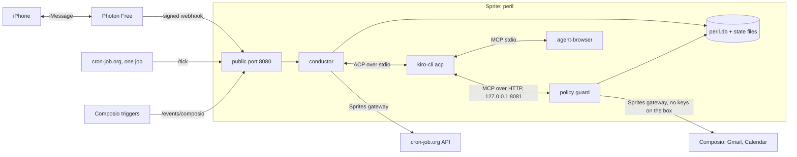

# About Peril's design

Peril is one Bun process on one Sprite, with one SQLite file and one `kiro-cli acp` child. That layout follows the Fak write-up: for one person, one process and one file make restarts, backups and debugging simple.

## The conductor decides whether Kiro runs

Every model call costs credits, so plain code answers first. The conductor drops redelivered webhooks, refuses strangers without calling Kiro, marks the owner's message read, reacts 👀, and settles tapback approvals and plain yes or no answers itself. A reminder saved as `say: <text>` is texted with no model call. A Composio email event wakes Kiro only when the sender appears in memory or the subject looks urgent and not like bulk mail. A watcher is a script that runs with no model, and Kiro hears about it only when the value changed and the condition holds.

Messages sent in a burst are combined after two seconds into one turn. A turn that runs past 20 seconds texts "on it" and delivers the answer when done.

## The guard is the only path to a side effect

Kiro calls Peril's tools over MCP. `packages/tools-mcp/src/guard.ts` runs every call through open-instinct's policy engine with Peril's owner overrides (`packages/core/src/peril-policy.ts`). Reads, reminders, drafts and holds on the owner's own calendar run at once. Sending email, inviting people, RSVPs, purchases and deletes create an approval and text it to the owner. Kiro's own permission prompts are a second check. The chat session never gets a shell or file writes. A deep session gets them only while it has not read outside content.

A side-effecting call writes a receipt before it runs (`packages/core/src/receipts.ts`). If Peril dies mid-send, the receipt stays `pending`. A repeat of the same call is refused, and Kiro is told to check the Sent folder or the calendar and ask. SMTP has no idempotency key, so the receipt is the only safe guard against a double send.

## Outside text is data

Email bodies, web pages, calendar descriptions and watcher output arrive wrapped in an `<external id="...">` tag with a random id per call. Lookalike tags inside the text are rewritten first. Reading outside text sets a taint flag on the session in SQLite. A tainted session cannot create watchers. The nightly job, or the owner texting `/fresh`, starts a clean chat session.

## The Sprite sleeps unless something is due

A sleeping Sprite cannot wake itself, so Peril keeps one cron-job.org job pointed at the next due minute and moves it when that changes (`packages/server/src/clock.ts`). A day with a briefing and two reminders costs three wake-ups. A message from the owner holds the Sprite awake for five minutes through the Sprites Tasks API, so the reply lands on a warm Kiro session. Work Peril started itself holds the Sprite only while it runs. Messages Peril starts on its own wait out quiet hours, 9pm to 8am IST.

## Kiro's sessions

The chat session uses a fast model and the deep session the strongest one, set per session with `_meta.kiro.modelId` on `session/new`. Peril stores each Kiro session id, so a cold wake resumes the conversation with `session/load`. An outside event gets a fresh, disposable event session with a tool-call cap. When Kiro's org login expires, Peril texts the owner how to sign in again, at most once an hour.
